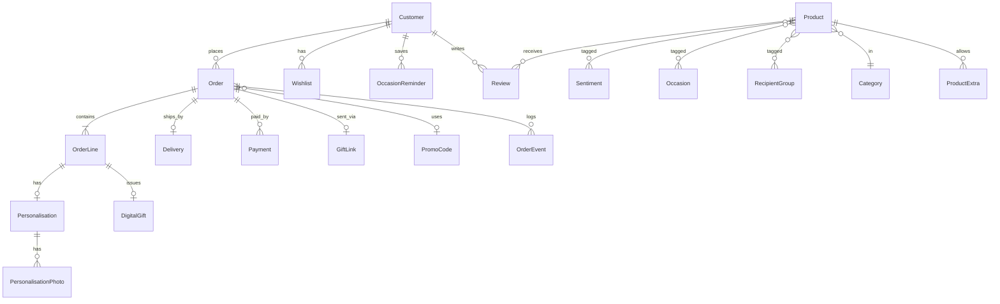

# Data Model (draft ERD)

About 18 entities, stored as JSON collections (one file each in `sentimently-api/data/`), not database tables. Only Product, Review and StoreConfig were seen in the prototype's network calls. The rest are inferred and must be checked after the test-account review (Q2). Store money as integer rupees. Every document has `id` (string), `createdAt`, `updatedAt`. Relations are ids; the store has no joins, so services join in memory. Small child records are embedded in their parent (Personalisation and photos in the order line, Delivery and events in the order).

## Diagram

## Entities

| Entity | Key fields | Notes |
|---|---|---|
| Product | slug, name, description, price, offerPrice, type (physical/digital), stock, leadTimeDays (min/max), isMadeToOrder, isPerishable, rating, reviewCount, isActive, categoryId | rating and reviewCount are derived from verified reviews |
| Sentiment, Occasion, RecipientGroup, Category | name, slug, blurb, image, sortOrder | Many-to-many to Product except Category (one per product). Counts: 14, 8, 6, 11 |
| ProductExtra | productId, extraCode | Which paid extras a product allows (rule PR-03) |
| Extra | code, name, price, isActive | Seed: premium wrap 350, keepsake box 750, chocolate box 1200, dried flower posy 900, express same-day 600 |
| Customer | email, name, phone, authProvider (email/google), passwordHash, role | Role: customer, staff, admin. Guest orders use email only (Q1) |
| Review | productId, customerId, orderLineId, rating, text, status | status: published/hidden. Verified = has a purchased order line |
| Wishlist | customerId, productId | Unique pair |
| OccasionReminder | customerId, label, date, recipientName, notifyDaysBefore | Sending is in B5 |
| PromoCode | code, percent, minOrder, firstOrderOnly, startsAt, endsAt, isActive | Seed: HELLO10 |
| Order | number, customerId or guestEmail, status, subtotal, extrasTotal, deliveryFee, discount, total, paymentMethod, promoCodeId, deliveryDate, city | Status machine in 04 |
| OrderLine | orderId, productId, quantity, unitPrice, lineTotal | |
| Personalisation | orderLineId, recipientName, relationship, message (900), cardDesign, packaging, extras | Photos in a child table |
| PersonalisationPhoto | personalisationId, storageKey, mimeType, deleteAfter | Private bucket |
| Delivery | orderId, address, city, deliveryDate, courier, trackingRef, status, attempts | |
| GiftLink | orderId, tokenHash, isClaimed, claimedAt, expiresAt, recipientAddress, recipientPhone | Token stored hashed. Single use |
| DigitalGift | orderLineId, type (egift/greeting), recipientEmail, sendAt, sentAt, code, expiresAt, status | |
| Payment | orderId, method, status, amount, gatewayRef, idempotencyKey | |
| OrderEvent | orderId, type, actorId, payload | Audit trail for status, refunds and cancellations |
| ContactMessage | name, email, phone, orderNumber, topic (6), subject, message, status | Also bulk-gifting enquiries (topic) |
| StoreConfig | single row: banner, announcement, freeDeliveryThreshold, deliveryRates (JSON), sameDayCutoff, sameDayCapacity per city, contact details | Seen by name only |
| Refund / ReturnRequest | orderId, reason, photos, status, amount, dueBy | May merge into Order flow in B5 |

## Open data questions
- Guest orders: one table with nullable `customerId`, or a shadow customer record (Q1).
- Do digital gifts live as order lines, or as a separate order type (decide with the tech lead).
- Soft delete versus hard delete for personal data on a deletion request (Q11).

## JSON collections (replaces the earlier SQL layout)
| Collection file | Holds | Embedded inside |
|---|---|---|
| taxonomy.json | Sentiment, Occasion, RecipientGroup, Category as one list with a `kind` field | |
| products.json | Product. References taxonomy by slug: `sentiments[]`, `occasions[]`, `recipients[]`, `category`; plus `allowedExtras[]` | |
| extras.json | Extra (seeded) | |
| customers.json | Customer | |
| reviews.json, wishlists.json, reminders.json | Review, Wishlist, OccasionReminder | |
| promoCodes.json | PromoCode (HELLO10 seeded) | |
| orders.json | Order | lines (with Personalisation and photos), Delivery, events |
| payments.json | Payment (own file so idempotency keys can be checked) | |
| giftLinks.json, digitalGifts.json | GiftLink, DigitalGift (`sendAt` and `status` scanned by the scheduler) | |
| contactMessages.json | ContactMessage | |
| storeConfig.json | StoreConfig (single document, delivery rates seeded) | |

Each collection is one file loaded whole, so orders.json grows with sales. That is acceptable for launch volume and is the first thing a durable driver should replace.
